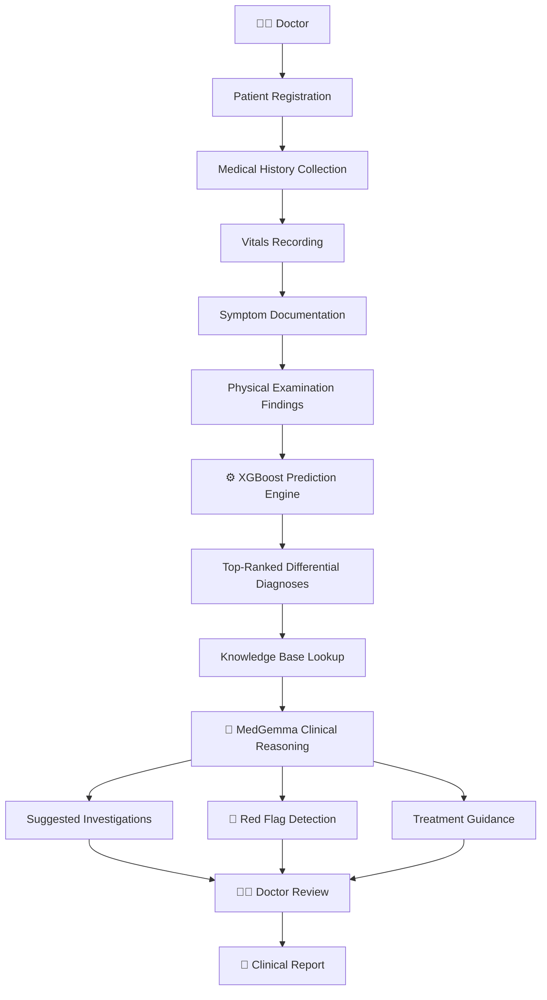
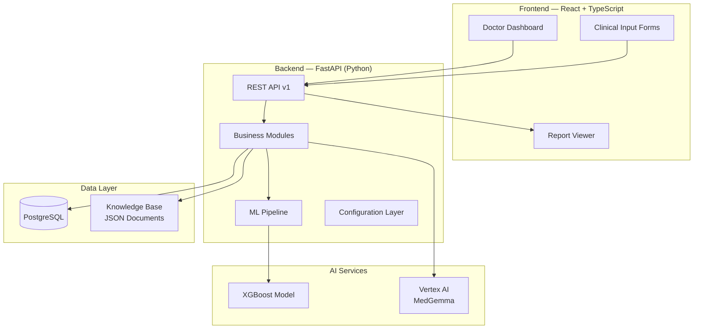

# MedIntel

### AI-Powered Clinical Decision Support System

> **Empowering clinicians with intelligent, evidence-based decision support — where artificial intelligence informs and the doctor decides.**

---

[](LICENSE)
[]()
[](https://fastapi.tiangolo.com)
[](https://react.dev)
[](https://xgboost.readthedocs.io)
[](https://cloud.google.com/vertex-ai)
[](https://www.postgresql.org)
[](https://www.docker.com)

---

## Table of Contents

- [Project Description](#project-description)
- [Vision](#vision)
- [Why MedIntel](#why-medintel)
- [Key Features](#key-features)
- [Clinical Workflow](#clinical-workflow)
- [AI Pipeline](#ai-pipeline)
- [System Architecture Overview](#system-architecture-overview)
- [Technology Stack](#technology-stack)
- [Project Structure](#project-structure)
- [Getting Started](#getting-started)
- [Installation](#installation)
- [Development Workflow](#development-workflow)
- [Roadmap](#roadmap)
- [Documentation](#documentation)
- [Security & Privacy Philosophy](#security--privacy-philosophy)
- [Contribution Guidelines](#contribution-guidelines)
- [License](#license)
- [Contact](#contact)

---

## Project Description

**MedIntel** is an AI-powered Clinical Decision Support System (CDSS) designed to assist licensed healthcare professionals in making faster, better-informed clinical decisions.

By combining a structured machine learning pipeline (XGBoost) with the clinical reasoning capabilities of Google's **MedGemma** large language model (via Vertex AI), MedIntel provides differential diagnosis rankings, investigation suggestions, red flag detection, and treatment guidance — all grounded in a curated clinical knowledge base.

> **⚠️ Clinical Disclaimer**: MedIntel is a decision support tool only. It does not diagnose, prescribe, or replace the clinical judgement of a licensed medical professional. All final clinical decisions remain the sole responsibility of the treating physician.

---

## Vision

Healthcare professionals face increasing cognitive load — managing complex patient histories, staying current with evolving clinical guidelines, and making high-stakes decisions under time pressure. Diagnostic errors remain a leading cause of preventable patient harm worldwide.

**MedIntel's vision** is to reduce that burden by putting a structured, evidence-informed AI assistant in every consulting room — one that surfaces relevant differentials, flags critical warning signs, and organizes clinical reasoning in a transparent, auditable way.

We believe AI in healthcare must be explainable, trustworthy, and deeply collaborative with the clinician — not a black box that replaces human expertise, but a reliable second opinion that enhances it.

---

## Why MedIntel

| Challenge | MedIntel's Approach |
|---|---|
| High diagnostic cognitive load | Ranked differential diagnoses from structured clinical input |
| Inconsistent guideline adherence | Curated knowledge base grounded in clinical guidelines |
| Missed red flags in complex cases | Dedicated red flag detection module |
| Lack of structured clinical reasoning | MedGemma-powered natural language reasoning trace |
| Time-consuming report generation | Automated structured clinical report drafts for doctor review |
| Investigation planning gaps | Evidence-linked investigation and lab test suggestions |

---

## Key Features

### ✅ Implemented
- Enterprise-grade modular project architecture
- Clean domain-separated backend module structure
- Dedicated ML pipeline directory (`feature_builder`, `preprocessor`, `model_loader`, `predictor`, `postprocessor`)
- Structured knowledge base with clinical domain separation
- Curated prompt library for MedGemma clinical reasoning
- Git version control with professional branch strategy
- Private GitHub repository with `.gitignore` and licensing

### 🔄 In Progress
- FastAPI backend API layer (v1 endpoints)
- XGBoost disease prediction service
- Knowledge base content population (diseases, symptoms, investigations)
- MedGemma clinical reasoning integration (Vertex AI)
- Doctor-facing dashboard (React + TypeScript)

### 🗓️ Planned (Version 2+)
- Patient management and longitudinal records
- Structured clinical report generation and export
- Analytics and clinical outcome tracking
- Follow-up and review scheduling recommendations
- Role-based authentication and access control
- Physiotherapy and rehabilitation support module
- Referral criteria and specialist escalation guidance
- Comprehensive audit logging for medico-legal compliance
- FHIR-compliant EHR/EMR integration

---

## Clinical Workflow

MedIntel follows a structured, clinician-guided workflow from patient registration to clinical report:



At every stage, the clinician remains in control. MedIntel augments clinical reasoning — it never replaces it.

---

## AI Pipeline

MedIntel's AI pipeline is a two-stage hybrid system combining structured prediction with language-based reasoning:

```mermaid
flowchart LR
    A[Structured Clinical Input\nSymptoms · Vitals · History · Examination] --> B[Feature Builder]
    B --> C[Preprocessor]
    C --> D[XGBoost Classifier]
    D --> E[Top-N Differential Diagnoses\nwith Confidence Scores]
    E --> F[Knowledge Base Enrichment\nGuidelines · Investigations · Red Flags]
    F --> G[MedGemma — Vertex AI\nClinical Reasoning LLM]
    G --> H[Reasoning Output\nInvestigations · Red Flags · Treatment · Summary]
    H --> I[Postprocessor\nStructured JSON Response]
    I --> J[Doctor Dashboard]
```



### ML Component — XGBoost
- Accepts structured numerical and categorical clinical features
- Trained on curated medical datasets
- Returns a probability-ranked list of differential diagnoses
- Lightweight, fast inference suitable for clinical time constraints

### LLM Component — MedGemma (Vertex AI)
- Google's medically-specialised large language model
- Receives enriched clinical context from the knowledge base
- Produces structured reasoning: investigations, red flags, treatment guidance, patient summary
- Outputs reviewed and presented to the clinician for approval

---

## System Architecture Overview



The architecture follows a clean separation of concerns: the frontend is stateless and communicates exclusively via versioned REST APIs. The backend is organized into discrete domain modules with a dedicated ML pipeline. The AI layer is loosely coupled, allowing model upgrades without disrupting the API contract.

---

## Technology Stack

| Layer | Technology | Purpose |
|---|---|---|
| **Backend** | FastAPI (Python) | High-performance REST API framework |
| **Frontend** | React + TypeScript | Type-safe, component-based UI |
| **Database** | PostgreSQL | Relational data store for clinical records |
| **ML Model** | XGBoost | Structured tabular disease prediction |
| **LLM** | MedGemma (Vertex AI) | Clinical language reasoning |
| **Cloud AI** | Google Vertex AI | Managed LLM inference and deployment |
| **Containerization** | Docker | Local and production containerization |
| **Orchestration** | Kubernetes *(planned v2)* | Production-scale container orchestration |
| **Version Control** | Git + GitHub | Source code management and collaboration |
| **CI** | GitHub Actions | Automated testing and code quality checks |

---

## Project Structure

```
medintel/
├── .github/
│   └── workflows/
│       └── ci.yml                  # GitHub Actions CI pipeline
├── backend/
│   ├── app/
│   │   ├── api/v1/endpoints/       # REST API route handlers
│   │   ├── config/                 # Application settings and constants
│   │   ├── db/                     # Database session and migrations
│   │   ├── ml/                     # XGBoost ML pipeline modules
│   │   └── modules/                # Domain business logic modules
│   │       ├── authentication/
│   │       ├── patient_management/
│   │       ├── clinical_assessment/
│   │       ├── prediction_engine/
│   │       ├── knowledge_engine/
│   │       ├── investigation_engine/
│   │       ├── reasoning_engine/
│   │       └── report_engine/
│   ├── Dockerfile
│   └── requirements.txt
├── frontend/
│   ├── src/
│   │   ├── assets/                 # Icons, images, themes
│   │   ├── components/             # UI, layout, forms, clinical components
│   │   ├── pages/                  # Application pages
│   │   ├── hooks/                  # Custom React hooks
│   │   ├── services/               # API communication layer
│   │   └── types/                  # TypeScript type definitions
│   ├── Dockerfile
│   └── package.json
├── models/
│   └── xgboost/
│       ├── artifacts/              # Trained model binaries
│       ├── config/                 # Feature columns, disease labels, metadata
│       ├── evaluation/             # Model evaluation results
│       ├── metadata/               # Model versioning and lineage
│       └── training/               # Training scripts and configuration
├── datasets/
│   ├── raw/                        # Original source datasets (gitignored)
│   └── processed/                  # Cleaned, feature-engineered datasets
├── knowledge_base/
│   ├── diseases/
│   ├── symptoms/
│   ├── physical_exam/
│   ├── investigations/
│   ├── lab_tests/
│   ├── imaging/
│   ├── medications/
│   ├── physiotherapy/
│   ├── red_flags/
│   ├── clinical_guidelines/
│   ├── referral_criteria/
│   └── followup/
├── prompts/                        # MedGemma prompt templates
│   ├── reasoning/
│   ├── patient_summary/
│   ├── investigations/
│   ├── treatment/
│   ├── red_flags/
│   ├── report/
│   ├── doctor_summary/
│   ├── missing_information/
│   ├── physiotherapy/
│   ├── followup/
│   └── compare/
├── specs/
│   ├── openapi/swagger.json        # API specification
│   └── MASTER_BLUEPRINT.md        # Master architecture document
├── tests/
│   ├── unit/
│   └── integration/
├── deployment/docker/
├── scripts/
│   ├── data_pipeline/
│   └── model_training/
├── docs/
│   ├── architecture.md
│   ├── api.md
│   ├── database.md
│   ├── clinical_workflow.md
│   └── data_dictionary.md
├── notebooks/
│   ├── eda.ipynb
│   └── model_training.ipynb
├── .env.example
├── .gitignore
├── docker-compose.yml
├── LICENSE
├── README.md
└── requirements.txt
```

---

## Getting Started

### Prerequisites

Ensure the following are installed on your development machine:

| Tool | Minimum Version | Notes |
|---|---|---|
| Python | 3.10+ | Backend runtime |
| Node.js | 18+ | Frontend toolchain |
| Docker | 24+ | Container runtime |
| PostgreSQL | 15+ | Or use the Docker Compose service |
| Git | 2.40+ | Version control |
| Google Cloud SDK | Latest | Required for Vertex AI access |

### Clone the Repository

```bash
git clone https://github.com/<your-username>/MedIntel.git
cd MedIntel
```

---

## Installation

### 1. Configure Environment Variables

```bash
cp .env.example .env
```

Edit `.env` and populate the following variables:

```env
POSTGRES_DB=medintel
POSTGRES_USER=your_db_user
POSTGRES_PASSWORD=your_db_password
VERTEX_AI_PROJECT_ID=your-gcp-project-id
VERTEX_AI_LOCATION=us-central1
SECRET_KEY=your_jwt_secret_key
```

### 2. Start Services with Docker Compose

```bash
docker-compose up --build
```

This starts:
- **Backend** API at `http://localhost:8000`
- **Frontend** UI at `http://localhost:3000`
- **PostgreSQL** database at `localhost:5432`

### 3. Backend Setup (Local Development)

```bash
cd backend
python -m venv .venv
source .venv/bin/activate        # Windows: .venv\Scripts\activate
pip install -r requirements.txt
uvicorn app.main:app --reload --port 8000
```

### 4. Frontend Setup (Local Development)

```bash
cd frontend
npm install
npm run dev
```

### 5. API Documentation

Once the backend is running, access the interactive API documentation:

- **Swagger UI**: `http://localhost:8000/docs`
- **ReDoc**: `http://localhost:8000/redoc`

---

## Development Workflow

```bash
# Create a feature branch
git checkout -b feature/your-feature-name

# Make your changes
# ...

# Run tests
cd backend && pytest tests/

# Stage and commit
git add .
git commit -m "feat: describe your change clearly"

# Push and open a Pull Request
git push origin feature/your-feature-name
```

### Branch Naming Convention

| Prefix | Purpose |
|---|---|
| `feature/` | New features or enhancements |
| `fix/` | Bug fixes |
| `docs/` | Documentation updates |
| `refactor/` | Code restructuring without behaviour change |
| `chore/` | Maintenance tasks, dependency updates |

### Commit Message Convention

We follow [Conventional Commits](https://www.conventionalcommits.org/):

```
feat:     New feature
fix:      Bug fix
docs:     Documentation change
style:    Formatting (no logic change)
refactor: Code restructure
test:     Adding or updating tests
chore:    Maintenance
```

---

## Roadmap

### Version 1 — MVP (Current)

| Milestone | Status |
|---|---|
| Project architecture and repository setup | ✅ Complete |
| Backend API layer (FastAPI) | 🔄 In Progress |
| XGBoost prediction service | 🔄 In Progress |
| Knowledge base content | 🔄 In Progress |
| MedGemma reasoning integration | 🔄 In Progress |
| Doctor dashboard (React) | 🔄 In Progress |
| Docker deployment | 🔄 In Progress |
| Unit and integration tests | 🔄 In Progress |

### Version 2 — Clinical Expansion

| Feature | Status |
|---|---|
| Patient management and longitudinal records | 🗓️ Planned |
| Structured clinical report generation | 🗓️ Planned |
| Role-based access control (RBAC) | 🗓️ Planned |
| Investigation suggestions with evidence links | 🗓️ Planned |
| Follow-up and review scheduling | 🗓️ Planned |
| Physiotherapy and rehabilitation guidance | 🗓️ Planned |
| Referral escalation criteria | 🗓️ Planned |
| Audit logging | 🗓️ Planned |
| Clinical analytics dashboard | 🗓️ Planned |

### Version 3 — Enterprise & Interoperability

| Feature | Status |
|---|---|
| FHIR-compliant EHR/EMR integration | 🗓️ Planned |
| Kubernetes production orchestration | 🗓️ Planned |
| ICD-10 and SNOMED CT terminology support | 🗓️ Planned |
| Multi-tenant hospital deployment | 🗓️ Planned |
| Model retraining pipeline | 🗓️ Planned |

---

## Documentation

Full project documentation is maintained in the [`/docs`](docs/) directory:

| Document | Description |
|---|---|
| [`architecture.md`](docs/architecture.md) | System design and component overview |
| [`api.md`](docs/api.md) | REST API endpoint reference |
| [`database.md`](docs/database.md) | Database schema and entity relationships |
| [`clinical_workflow.md`](docs/clinical_workflow.md) | End-to-end clinical workflow documentation |
| [`data_dictionary.md`](docs/data_dictionary.md) | Clinical feature definitions and data types |
| [`specs/MASTER_BLUEPRINT.md`](specs/MASTER_BLUEPRINT.md) | Master architecture blueprint |

---

## Security & Privacy Philosophy

MedIntel is designed with patient safety and data privacy as first-order requirements, not afterthoughts.

- **No patient data is stored by AI models.** Clinical data sent to Vertex AI is governed by Google Cloud's enterprise data processing agreements.
- **Environment secrets** are never committed to the repository. All credentials are managed through environment variables and a secrets management strategy.
- **Authentication** will enforce role-based access control, ensuring only authorised clinical personnel access patient records.
- **Audit logging** (planned) will record all clinical queries and AI interactions for medico-legal review.
- **The AI never makes a final diagnosis.** All AI outputs are clearly labelled as decision support and require explicit physician review and sign-off.

---

## Contribution Guidelines

MedIntel welcomes contributions from software engineers, clinical informaticists, data scientists, and healthcare professionals.

### How to Contribute

1. Fork the repository.
2. Create a feature branch from `main`.
3. Write clear, tested, and documented code.
4. Submit a Pull Request with a detailed description of your changes.
5. All PRs are reviewed before merging to `main`.

### Areas Where Contributions Are Particularly Welcome

- Knowledge base content (clinical guidelines, disease profiles)
- ML model improvements and evaluation
- Frontend UX for clinical workflows
- Test coverage expansion
- Documentation and technical writing
- Security review and hardening

### Code of Conduct

All contributors are expected to maintain a professional, respectful, and inclusive environment. Clinical accuracy and patient safety considerations must be factored into every contribution.

---

## License

This project is licensed under the **MIT License**.

See the [LICENSE](LICENSE) file for full terms.

> **Note**: While the software is MIT-licensed, any clinical deployment of MedIntel must comply with applicable healthcare regulations, data protection laws, and medical device standards in your jurisdiction.

---

## Contact

**Project Lead & Architect**
Maintained by the MedIntel development team.

For inquiries related to:
- **Technical collaboration**: Open a GitHub Issue or Discussion.
- **Clinical advisory**: Raise a Discussion thread tagged `clinical-review`.
- **Security vulnerabilities**: Please do **not** open public issues. Contact the maintainers directly through GitHub's private security advisory feature.

---

<div align="center">

---

*MedIntel is being built with the conviction that AI can make healthcare smarter, safer, and more equitable — one clinical decision at a time.*

*Every line of code here is a step toward a future where no doctor has to face a complex case alone.*

---

**MedIntel** · AI-Powered Clinical Decision Support · Version 1 (MVP) · MIT License

</div>
